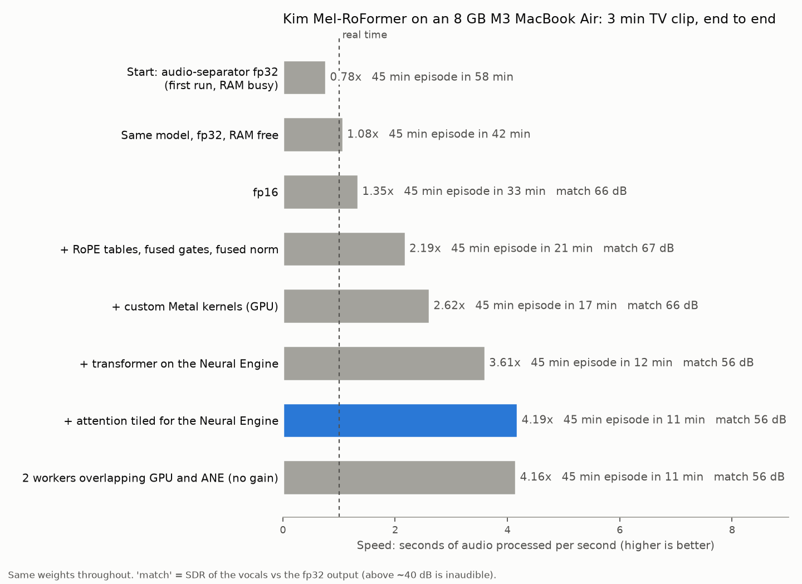

# fast-melroformer

Kim's Mel-Band RoFormer vocal model, made to run about 4x faster than real time on an 8 GB M3 MacBook Air.

The weights are the original ones. Over a 3 minute clip the output matches the fp32 run at 56.5 dB SDR, which you can't hear. A 45 minute TV episode takes about 11 minutes instead of 42.



## How it got faster

Measured end to end on the same 3 minute clip:

| step | speed vs real time |
|---|---|
| stock model, PyTorch fp32 on the GPU (MPS) | 1.08x |
| fp16 | 1.35x |
| RoPE and RMSNorm moved off fp32, output gates folded into the qkv matmul | 2.19x |
| custom Metal kernels for the attention glue | 2.62x |
| the 12 transformer blocks on the Neural Engine (Core ML) | 3.61x |
| time attention split into small tiles so it fits the Neural Engine | 4.19x |

The biggest surprise was the rotary embeddings. They ran in fp32 and rebuilt their angle tables on every call, which ate 30 to 46% of attention time on MPS. Fixing that is a small patch (`fastmbr/patch.py`) that helps any Mac user of this model.

Quantization would not have helped speed. 88% of the weights sit in the mask estimators, and those take only 4% of the time.

`NOTES.md` has every measurement, including the ideas that failed.

## Run it

You need an Apple Silicon Mac, macOS 15 and [uv](https://github.com/astral-sh/uv).

```bash
git clone https://github.com/aipdv/fast-melroformer && cd fast-melroformer
uv sync
.venv/bin/audio-separator --download_model_only -m vocals_mel_band_roformer.ckpt --model_file_dir ~/models/melroformer
bench/guard.sh .venv/bin/python bench/ane_stack.py convert   # builds the Neural Engine model, once
.venv/bin/python -m fastmbr.separate episode.mp4 -o out/
```

You get `episode_vocals.wav` and `episode_other.wav`. The first run compiles the model for the Neural Engine, which takes about 5 minutes. After that it loads in 2 seconds.

`--engine gpu` uses only the GPU path (2.6x). `--engine ref16` and `--engine ref32` run the unmodified model for comparison.

## Things to know

- I only tested on one machine: an 8 GB M3 MacBook Air with no fan. It slows down when it gets hot, so long files run a bit below 4x.
- The Neural Engine runs in fp16. The full clip matches at 56.5 dB, but one quiet passage matched at 40 dB, which is right around where a difference could start to be heard. Listen to quiet scenes if quality matters to you.
- `bench/guard.sh` runs one job at a time and stops it if RAM gets low. Running two of these jobs at once froze my 8 GB Mac.
- coremltools warns that it hasn't been tested with this torch version. It worked anyway.

## Layout

- `fastmbr/patch.py`: GPU fixes on top of audio-separator's model.
- `fastmbr/metal.py`: custom Metal kernels.
- `fastmbr/ane.py`: the transformer rewritten for the Neural Engine.
- `fastmbr/hybrid.py`: Neural Engine for the transformer, GPU for the rest.
- `fastmbr/separate.py`: the command line tool.
- `bench/`: the scripts behind every number.

## Credits

The model is by Kimberley Jensen ([weights](https://huggingface.co/KimberleyJSN/melbandroformer), MIT). The reference implementation comes from [python-audio-separator](https://github.com/nomadkaraoke/python-audio-separator), and the architecture is from the Mel-Band RoFormer paper by Wang, Lu and Won.
